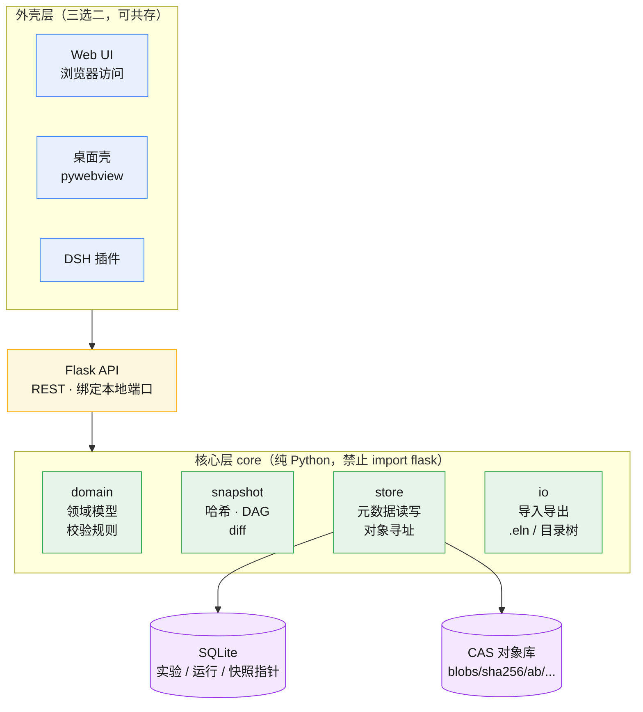
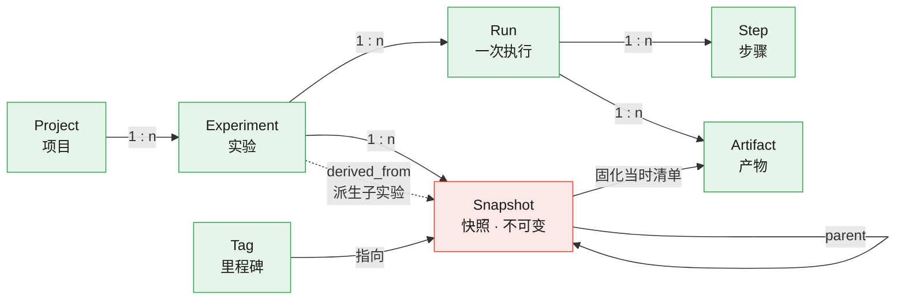
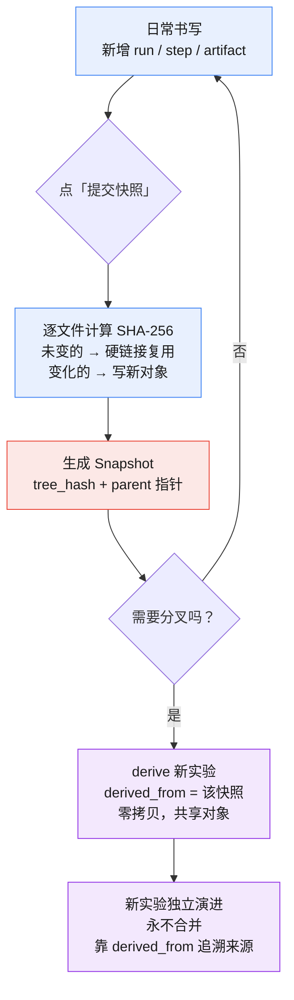
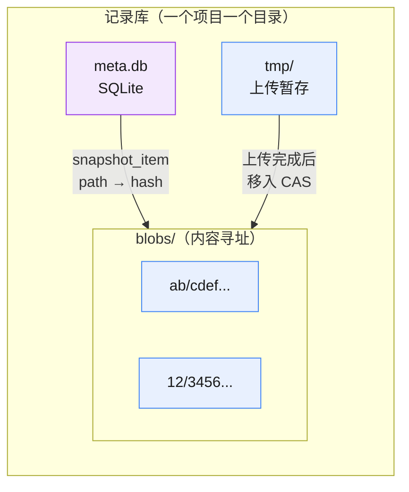

# 架构图

> 配套 [ARCHITECTURE.draft.json](ARCHITECTURE.draft.json)。JSON 给校验器读，本页给人看。
> 决策基线：D-6=A（整实验快照）、D-1=B（派生子实验）、D-2=A（全量内容寻址 + 硬链接）。

---

## 1. 分层架构

核心层是唯一的大脑，三种外壳只是它的不同出口。**`core` 禁止 `import flask`**——这条是双形态能成立的前提。

---

## 2. 领域模型

分叉落在实验层，不落在版本层——所以没有 `branch` 表，只有 `derived_from` 指针。

**不可变红线**：`Snapshot` 一旦创建，内容与父指针都不可改。修改只能产生新快照——和 `ARCHITECTURE.json` 只读原则同源。

---

## 3. 快照与派生流程

关键在「逐文件计算哈希」这一步：内容没变的文件不复制，直接硬链接复用。这让「整实验快照」并不重。

---

## 4. 存储布局

同一份内容只存一份；快照之间靠哈希共享，不靠复制。

---

## 5. API 清单

25 个端点，全部 `planned`。**绿色 = 写操作**（有 `codegen` 节点，可用 `scaffold_from_arch.py` 生成骨架），**蓝色 = 读操作**。

| 分组 | 方法 | 路径 | 说明 |
|---|---|---|---|
| 系统 | `GET` | `/api/health` | 健康检查 |
| 项目 | `GET` | `/api/projects` | 列表 |
| 项目 | 🟢 `POST` | `/api/projects` | 新建项目 |
| 项目 | `GET` | `/api/projects/{id}` | 详情 |
| 实验 | `GET` | `/api/experiments` | 列表，按 `project_id` 过滤 |
| 实验 | 🟢 `POST` | `/api/experiments` | 新建实验 |
| 实验 | `GET` | `/api/experiments/{id}` | 详情 |
| 实验 | 🟢 `PATCH` | `/api/experiments/{id}` | 改标题/假设/参数 |
| 实验 | 🟢 `POST` | `/api/experiments/{id}/derive` | **派生新实验**（D-1=B） |
| 实验 | `GET` | `/api/experiments/{id}/export` | 导出 |
| 运行 | `GET` | `/api/experiments/{id}/runs` | 运行列表 |
| 运行 | 🟢 `POST` | `/api/experiments/{id}/runs` | 开始一次运行 |
| 运行 | `GET` | `/api/runs/{id}` | 运行详情 |
| 步骤 | `GET` | `/api/runs/{id}/steps` | 步骤列表 |
| 步骤 | 🟢 `POST` | `/api/runs/{id}/steps` | 追加步骤 |
| 产物 | 🟢 `POST` | `/api/runs/{id}/artifacts` | 上传文件，写入 CAS |
| 产物 | `GET` | `/api/artifacts/{id}/content` | 按哈希取回内容 |
| 快照 | 🟢 `POST` | `/api/experiments/{id}/snapshots` | **冻结整个实验**（D-6=A） |
| 快照 | `GET` | `/api/experiments/{id}/snapshots` | 快照历史 |
| 快照 | `GET` | `/api/snapshots/{id}` | 快照元数据 |
| 快照 | `GET` | `/api/snapshots/{id}/tree` | 快照内容树 |
| 快照 | `GET` | `/api/snapshots/{a}/diff/{b}` | 两个快照的差异 |
| 快照 | `GET` | `/api/snapshots/{id}/verify` | **完整性校验**（D-2=A 的前提） |
| 标签 | `GET` | `/api/snapshots/{id}/tags` | 标签列表 |
| 标签 | 🟢 `POST` | `/api/snapshots/{id}/tags` | 打里程碑标签 |

> `verify` 只在全量寻址（D-2=A）下才有确定结论。若当初选了引用模式，它只能报告「引用已失效」，给不出答案。
